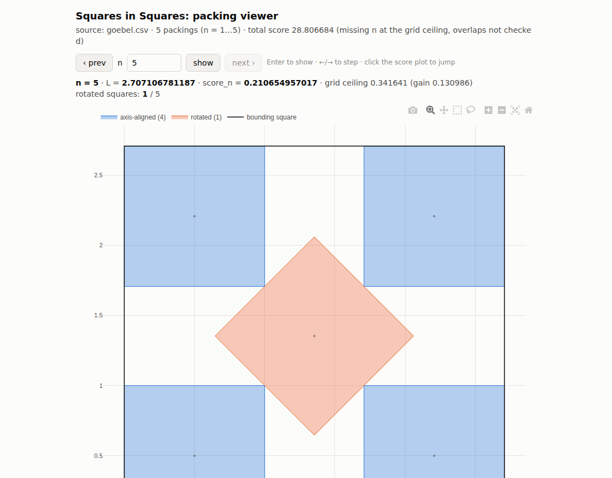

# Kaggle: Visualize Squares in Squares

Interactive viewer for submission files of the Kaggle competition
[Squares in Squares](https://www.kaggle.com/competitions/squares-in-squares): one self-contained HTML page that shows
any of the 1000 packings (pick `n`, step with prev/next, click a point on the score plot), with the bounding square,
the side length `L`, the per-puzzle score `L/√n − 1`, and squares coloured by rotation (axis-aligned, nearly aligned,
rotated). Works offline; the page embeds all data and, by default, plotly.js.

It is a **viewer, not a validator**: it does not check overlaps or the submission format in depth. Use the official
metric notebook for that. `L` follows the metric's bounding-box definition (max of the x- and y-extent of all
corners), computed in float64 rather than mpmath.

## Live demo

- Full competition baseline (1000 grid packings, the official `sample_submission.csv`): **https://rusiek.github.io/squares-in-squares-vis/**
- Tiny example with a rotated square (Göbel's n = 5, L = 2 + 1/√2): **https://rusiek.github.io/squares-in-squares-vis/goebel.html** (deep link to a puzzle: append `#n=5`)

Both pages are exactly what `sis-vis` produces (`--cdn` variant); sources in `docs/`.



## Install

```bash
pip install git+https://github.com/Rusiek/squares-in-squares-vis
# or, isolated:
pipx install git+https://github.com/Rusiek/squares-in-squares-vis
```

Requires Python ≥ 3.10; pulls in numpy, pandas and plotly.

## Use

Command line:

```bash
sis-vis submission.csv packings.html        # build the page (≈10 MB for 1000 puzzles, <1 s)
sis-vis submission.csv packings.html --cdn  # smaller page, loads plotly.js from the CDN when opened
```

Python / notebook:

```python
from squares_in_squares_vis import PackingViewer

v = PackingViewer("submission.csv", "packings.html")
v.build()          # writes the HTML page
v.show(5)          # one packing inline (plotly figure)
v.show_scores()    # score_n over n
```

Input: the competition's CSV format (`id,n,square_id,x,y,angle`, angle in radians, unit squares).

## Develop

```bash
git clone https://github.com/Rusiek/squares-in-squares-vis && cd squares-in-squares-vis
pip install -e ".[test]" && pytest -q
```

## Licence

Apache-2.0. The same viewer is published as a Kaggle notebook; this repository is the installable version.
